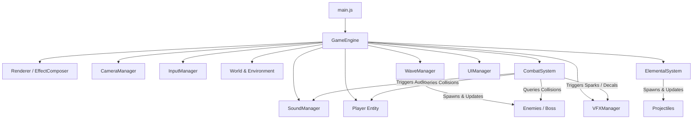

# TECHNICAL ARCHITECTURE DOCUMENTATION
# ELEMENTAL LEGENDS: RISE OF THE FALLEN KING

---

## 1. System Overview & Component Diagram

The application is structured into decoupled, modular systems communicating through clean event hooks, state queries, and manager interfaces.

---

## 2. Subsystem Breakdown

### 2.1 Rendering Pipeline (`src/core/Renderer.js`)
- **Engine**: Three.js WebGLRenderer.
- **Tone Mapping**: `THREE.ACESFilmicToneMapping` with exposure tuned to 1.15 for high dynamic range dark-fantasy contrast.
- **Shadows**: `THREE.PCFSoftShadowMap` with 2048x2048 resolution directional light frustum and filtered penumbras.
- **Post-Processing**:
  * Managed via `EffectComposer` with `RenderPass` and `UnrealBloomPass` (strength: 0.75, radius: 0.35, threshold: 0.7) to create radiant glows on molten weapons, lightning bolts, and arcane runes.
  * **Graceful Fallback**: Automatically disables Bloom and downgrades shadow resolution if the client WebGL context does not support floating-point textures or when the user selects 'Medium' or 'Low' graphics quality.

### 2.2 Camera System (`src/core/CameraManager.js`)
- **Type**: Third-person orbital follow camera.
- **Smoothing**: Spherical coordinates (Yaw, Pitch, Distance) interpolated with spring-damping (`smoothSpeed = 12.0`) to avoid rigid jarring or camera clipping.
- **Lock-On Target Tracking**: Calculates the midpoint vector between the player and the locked enemy, orienting the yaw while maintaining situational awareness.
- **Screen Shake**: Decaying offset vector applied to camera position on impacts, explosions, and boss slams.

### 2.3 Input Subsystem (`src/core/InputManager.js`)
- Handles Pointer Lock API lifecycle (`requestPointerLock` / `pointerlockchange`).
- Maps raw keyboard events to action flags (`consumeAction`), preventing dropped frames or missed buffered clicks.
- Translates mouse delta with user-configurable sensitivity.

### 2.4 Procedural Asset Pipeline (`src/entities/CharacterModelBuilder.js`)
- **Why Procedural 3D Models?**:
  * 100% self-contained: Eliminates multi-megabyte external GLTF downloads, CORS cross-origin blocking, broken CDN links, or licensing ambiguities.
  * Instantaneous loading (<50ms startup time).
  * High artistic consistency across Hero, Soldiers, Cultists, Knights, and The Fallen King.
- **Hierarchical Rigging**:
  * Models are constructed with nested joint groups (`hips` ➔ `spine` ➔ `shoulder` ➔ `elbow` ➔ `hand` ➔ `weapon`), allowing procedural forward kinematics for idle breathing, walk cycles, combo swings, rolls, and hit reactions.
- **Procedural Canvas Textures**:
  * Inlaid runic patterns and brushed metal micro-scratches generated directly onto HTML5 canvases at runtime and uploaded as `THREE.CanvasTexture` with anisotropic filtering.

### 2.5 Procedural Audio Synthesizer (`src/core/SoundManager.js`)
- Uses the **Web Audio API** (`AudioContext`, `GainNode`, `BiquadFilterNode`, `OscillatorNode`, and `AudioBufferSourceNode`).
- **Sound Generation Profiles**:
  * *Blade Swooshes*: Bandpass-filtered white noise with exponential frequency ramps and tonal metallic sines.
  * *Metallic Impacts*: Clinking sines combined with decaying low-frequency triangle thuds.
  * *Fire Magic*: Lowpass filtered noise bursts with pitch descent.
  * *Ice Magic*: High-frequency cascading sine chime arpeggios simulating crystal fractures.
  * *Lightning*: Sawtooth oscillator sweeps with fast distortion and crackle bursts.
  * *Dark Fantasy BGM*: Procedural D-minor Phrygian progression (`Dm` ➔ `Bb` ➔ `Gm` ➔ `A / C#dim`) layered over sub-bass drones and dynamic battle drums that scale with combat intensity.

### 2.6 Combat & Collision Logic (`src/systems/CombatSystem.js`)
- **Active Damage Window**: Damage frames are active only during specific intervals of each swing (`isWeaponActive`), preventing continuous damage ticks.
- **Hit Caching**: Uses a `Set` to record which enemies have been struck during the current swing, guaranteeing that each enemy receives damage exactly once per attack animation.
- **Knockback Physics**: Applies directional impulse away from the player based on attack weight (light combo vs heavy slam).
- **Invulnerability Frames**: Player dodge roll activates a boolean flag `isInvincible` for 0.42 seconds, bypassing all incoming enemy damage checks.

---

## 3. Known Limitations & Technical Notes

1. **Browser Pointer Lock Policy**:
   - Modern browsers require an explicit user gesture (such as clicking the canvas or pressing Start Game) before granting Pointer Lock. The game gracefully requests lock on the first canvas click.
2. **Audio Autoplay Policy**:
   - Browsers suspend the `AudioContext` until the first user interaction. The `SoundManager` safely initializes and resumes the audio context upon clicking "Start Game" or clicking anywhere on the screen.
3. **Complex Skeletal Skinning vs Joint Groups**:
   - The game utilizes hierarchical Three.js `Group` forward kinematics rather than skinning weights (`SkinnedMesh`). This delivers exceptional performance (consistently 60+ FPS even on integrated GPUs) and zero bone texture limits.
